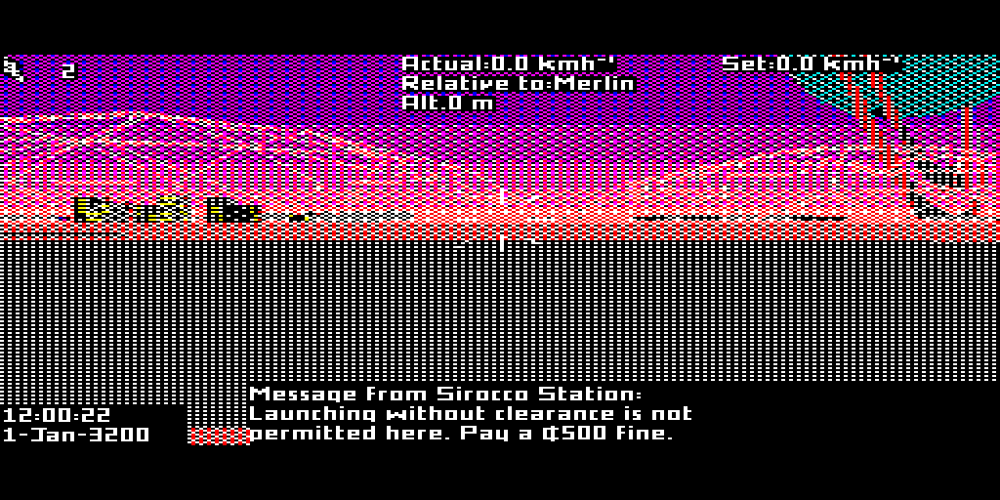
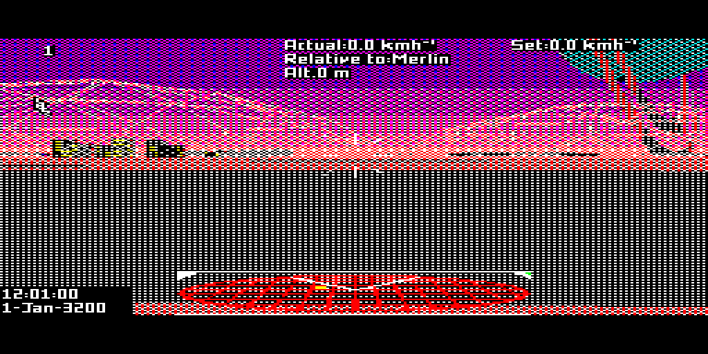

# Frontier QL — messages and save/load (experiment 07a)

**07a small fix:** Ctrl+Left now acts as Backspace in text entry, including
save names. QLBox's host Backspace emits this same QL chord. Plain Left is
unchanged, and release uses the remembered translated key even if Ctrl is
released first. Applied to both executables; no display or save-format changes.
A QLBox keyboard probe verified make/release codes and ordinary Left; `make
check` passed. Other screenshots and runtime results below are from 07.

One source tree builds `build/frontier0` and `build/frontier8` using JAS.

| Executable | Display |
|---|---|
| frontier0 | Original four-colour Mode 4 view and control panel, with readable text. |
| frontier8 | Eight-colour Mode 8 flight view, readable HUD and overlaid scanner; Mode 4 information screens. |

The `0` is the variant name: its physical QL screen mode is Mode 4.

## Messages over the scanner

`frontier8` now prints active communications over the scanner in the original
font, solid white on an opaque black backing. The portrait is omitted. The
original sender, wording, line wrapping, queue, timing and expiry are retained.
The scanner returns automatically when the message expires.



The HUD replays only the original active communication's formatter. It does
not reissue the message, restart its timer, issue another fine, or change its
queue. It uses the existing native text plane and adds only a two-byte origin
field. Text bypasses dithering; scene dithering remains unchanged.

The `frontier0` HUD, panel, viewport, palettes and dithering are unchanged from
experiment 06. Both executables receive the shared file-service fixes below.

## Saving and loading

Use the game's own menus:

1. Press **Esc**, then **Esc** again to open Preferences.
2. **Shift+F3** (the QL mapping of F8) opens Save. Press **Enter** to save under
   the displayed commander name. The original name-edit button is available.
3. **Shift+F2** (F7) opens Load. Click the desired commander file.

The displayed DOS drive `A:` maps to **WIN1_**. With QLBox `--run`, this is the
host directory containing the executable. Place the two executables together
in a writable game directory to share commander files. On QDOS, assign WIN1_
to the writable location you want to use. The adapter supports a flat directory;
it does not implement a DOS directory hierarchy or alternate drive selection.

Frontier defaults to extensionless saves such as `Jameson`. Its original
“use filename extensions” preference enables numbered suffixes such as `._01`.
Saving to an existing name uses the existing overwrite behaviour; use distinct
commander names or numbered extensions when keeping several saves.

Two native adapter bugs were fixed:

- Directory enumeration formerly admitted only `.CMD`, hiding the game's real
  save names. It now admits regular files with DOS-compatible names of 1–12
  characters, including extensionless and numbered saves. Executables and
  QDOS directories are excluded. Keep source/build files outside the play
  directory to keep the selector uncluttered.
- QDOS directory sizes include a 64-byte header. The GEMDOS-style interface now
  reports just payload bytes. Previously a load tried to read 64 bytes too many
  and displayed the original game's misleading “Disc Full” error.

The original save serializer, compression, encryption and checksum are used.
No new save format was introduced. Compatibility with other Frontier editions
or arbitrary historical port builds has not been established.



## Build and run

Requirements: POSIX make, C compiler and Python 3. JAS/linker sources and QDOS
libraries are included; no cross C compiler is required.

```sh
make                  # both executables
make check            # source conversion, branches and frozen Mode 4 regressions
make frontier0        # individual target
make frontier8
```

The shared generated-source stamp is now an explicit object prerequisite, so
an incremental source change rebuilds the executable in the same make invocation.

```sh
/path/to/qlbox --no-config --rom minerva --ram 1m --no-qsound --speed 8 --run build/frontier8
```

Use windowed QLBox for play. **1** starts the game; **F2** opens the map;
**F1** returns to flight; **Shift+F1–F5** supplies F6–F10; **Ctrl+Esc** exits.
Hold keys through slow redraws if necessary. Mouse operation uses QIMSI input.

Binaries: `frontier0` 611,032 bytes; `frontier8` 632,046 bytes, including loader
metadata. Tested under QLBox R24/Minerva with 1 MB. No sound or runtime floating
point was added. Physical hardware and stock 68008 performance remain untested.

## Validation

- All 537,120 original loaded bytes match the reference JAS conversion;
  6,638 original game branches checked per variant, plus native branch ranges.
- Original mode0 game translation, all 65,536 dither bytes and palette services
  match the frozen baselines.
- Mode0 options: all 63,744 pixels outside the parked cursor match the original
  layout/dither and solid-text oracle; four boundary guards intact.
- Genuine launch-without-clearance warning triggered by game input: original
  three lines match every font stroke and all 6,144 opaque overlay pixels.
  Subsequent capture confirms original expiry and scanner restoration.
- Native flight text/FPS, six memory guards and all 51 raster extent switches
  checked in the new build.
- Original Save menu created a 4,054-byte encrypted commander. Its original
  checksum was independently verified. A fresh emulator job selected it through
  the original Load menu and returned to flight; commander name, date, system,
  manifest and selected file length match the saved data.
- Native file probe checks create/write/close/read past EOF, payload comparison,
  directory enumeration and exact payload length, delete, and not-found for
  extensionless and numbered save names.

The UI save/load round trip was exercised in `frontier8`; `frontier0` uses the
same corrected native file services. Neither executable changes original save
logic. See `tests/` for checks and input scripts, and `evidence/testing.txt` for
results. The R24 test harness patch adds physical key/mouse events and optional
periodic captures; it does not alter game state or either delivered executable.
Mouse test lines use `frame -1 dx dy` (PS/2 signed Y) and
`frame -2 buttons 0`. Regular lines are `frame QL-key modifiers down`.

Earlier display implementation notes are retained in README-experimental05.md
and README-experimental06.md. Their version claims and paths are historical.
